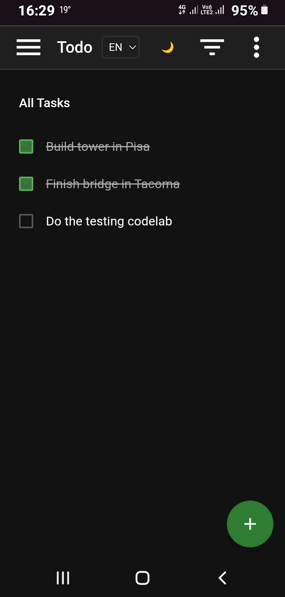

# Creating Automated UI Tests on Android with Kotlin and Espresso

Project developed during the **Quality Assurance (QA) Experience Bootcamp** under the guidance of specialist **[Caroline Tenorio Ribeiro](https://www.linkedin.com/in/carolinetenorio/ "Caroline Tenorio Ribeiro")**.

Get the most out of this challenge by replicating the project carried out by the experts, with the goal of incorporating new features and improvements that make your tests even more robust and effective. To do this, create your own project (or reproduce the one presented by the experts) with the aim of developing your own UI test scenarios.

This project it showcases a robust, production-ready Task Management (ToDo) application built using modern Android architecture components, structured to demonstrate advanced UI test automation using **Espresso** and **Kotlin**.

## Features

- **Task Management (CRUD):** Add, view, edit, and delete tasks cleanly through a decoupled reactive architecture.
- **Status Filtering:** Filter your task stream dynamically by *All*, *Active*, and *Completed* states.
- **Live Statistics:** Real-time data calculation showing completed vs. active task percentages instantly.
- **Navigation Architecture:** Full integration with Jetpack Navigation components using safe arguments (`Safe Args`).

## Architecture & Technologies

The codebase strictly follows the  software engineering guidelines for Android development:

- **Language:** 100% Kotlin.
- **Architecture Pattern:** MVVM (Model-View-ViewModel) with structured unidirectional data flow.
- **Data Binding:** Direct layout bindings to eliminate UI boilerplate and improve testability.
- **Asynchronous Layer:** Kotlin Coroutines managing repository background operations flawlessly.
- **Logging:** Instrumented using Timber for clean, non-leaking console diagnostics.

## UI Test Suite (Espresso Implementation)

The automation core focuses on UI and End-to-End (E2E) behaviors using the AndroidX Test library and Espresso framework:

- **`createNewTask_and_checkInList`:** Simulates a user navigating to the creation screen, inputting text into fields, saving, and asserts that the task is correctly bound and displayed in the main list.
- **`completeTask_and_verifyStatistics`:** Validates data continuity across different fragments. It creates a task, marks it as completed via a checkbox toggle, navigates through the Navigation Drawer, and asserts that the Statistics engine displays the correct calculations.

### Running the Tests

To execute the automated instrumentation tests:

1. Connect an Android Device or start an Android Emulator.
2. Open the project inside **Android Studio**.
3. Right-click on the `TasksActivityTest` file located inside `app/src/androidTest/java/` and select **Run 'TasksActivityTest'**.
4. Alternatively, use the command-line interface:

   ```bash
   ./gradlew connectedAndroidTest
   ```



[LICENSE](/LICENSE)
